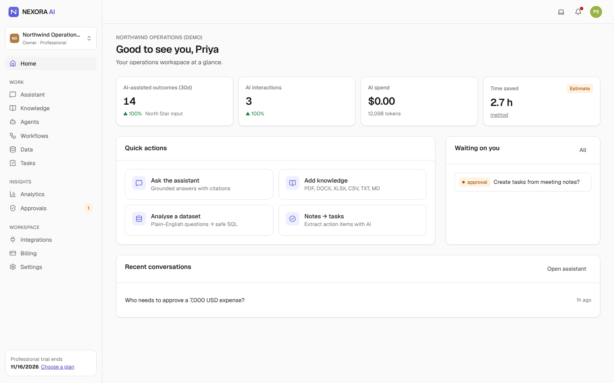

# NEXORA AI

**One Intelligent Workspace. Infinite Business Possibilities.**

NEXORA AI is an AI business-operations & workflow-intelligence SaaS for growing teams: grounded answers from your own documents,
agents with human approval, visual workflow automation, safe natural-language analytics, AI-assisted tasks, and an executive
dashboard that measures outcomes and AI cost — multi-tenant, role-based and audited.

> Independently conceptualised, designed and built as a product-management portfolio project. No real customers, revenue or usage
> exist; all business figures are labelled hypotheses. AI runs in a clearly labelled **demo engine** unless provider keys are configured.



## What's inside
| Area | Highlights |
|---|---|
| **Product** | 12 modules: auth/orgs/RBAC · assistant · knowledge & RAG · agent studio · workflows · data intelligence · tasks · analytics · billing · integrations · notifications · admin console |
| **AI** | Provider-neutral gateway (Anthropic Messages API, OpenAI Responses API, demo engine) with task-based routing, fallback, caching, PII redaction, cost ledger · hybrid pgvector + full-text RAG with reranking and verified citations · persisted agent runtime with approvals · NL→SQL with AST guard · evaluation framework |
| **Engineering** | FastAPI + SQLAlchemy + Alembic · PostgreSQL 16 + pgvector · Redis · Postgres job queue/worker · Next.js 15 + React 19 + Tailwind v4 + React Flow + Recharts · Docker/Compose · GitHub Actions |
| **Quality** | 90 pytest · 6 Vitest · 8 Playwright E2E (also on the Docker stack) · Newman API suite · AI eval run · load test · pip-audit/npm audit clean |
| **Product management** | Vision, strategy, desk research with sources, competitive analysis, personas, journeys & wireframes, PRD, RICE/ICE/MoSCoW backlog (Jira CSV), roadmap & risks, analytics framework & North Star, experiments, monetisation, GTM, 36-month financial model (xlsx), decision log, case study, executive deck |

## Quick start
```bash
cp .env.example .env    # set JWT_SECRET and ENCRYPTION_KEY (commands in the file); add AI keys optionally
docker compose -f deployment/docker-compose.yml --env-file .env up -d --build
open http://localhost:3000
```
Local dev, seeding demo data and production deployment: **[docs/DEPLOYMENT_GUIDE.md](docs/DEPLOYMENT_GUIDE.md)**.

## Repository map
```
frontend/        Next.js app (marketing site, product, admin console), Vitest, Playwright E2E
backend/         FastAPI modular monolith, Alembic migrations, pytest suite
ai-engine/       Golden evaluation dataset, eval runner, results
agent-workflows/ Agent templates & tool catalogue (exported), runtime notes
automation/      Workflow recipes, n8n workflows (both directions)
integrations/    Integration catalogue & semantics
database/        Analytics (Power BI) views
deployment/      Docker Compose, SQL for read-only BI role
tests/           Postman collection, performance test + results
scripts/         Seeding, financial model, backlog, reference-doc generators, screenshot tour
docs/            Product, business and technical documentation (index below)
.github/         CI (lint, tests, eval, audits, E2E on compose, secret scan), Dependabot
```

## Documentation index
**Product:** [Vision](docs/PRODUCT_VISION.md) · [Strategy](docs/PRODUCT_STRATEGY.md) · [Market research](docs/MARKET_RESEARCH.md) ·
[Competitive analysis](docs/COMPETITIVE_ANALYSIS.md) · [Personas](docs/USER_PERSONAS.md) · [Journeys & wireframes](docs/USER_JOURNEYS.md) ·
[PRD](docs/PRD.md) · [Prioritisation](docs/PRIORITISATION.md) ([backlog CSV](docs/product/backlog.csv)) · [Roadmap](docs/PRODUCT_ROADMAP.md) ·
[Analytics framework](docs/ANALYTICS_FRAMEWORK.md) · [Experimentation plan](docs/EXPERIMENTATION_PLAN.md) · [Decision log](docs/PRODUCT_DECISION_LOG.md) · [Release notes](docs/RELEASE_NOTES.md)
**Business:** [Monetisation](docs/MONETISATION_STRATEGY.md) · [GTM](docs/GTM_STRATEGY.md) · [Financial model](docs/FINANCIAL_MODEL.md) ([xlsx](docs/business/NEXORA_Financial_Model.xlsx))
**Technical:** [Architecture](docs/TECHNICAL_ARCHITECTURE.md) · [Database schema](docs/DATABASE_SCHEMA.md) · [API](docs/API_DOCUMENTATION.md) ([OpenAPI](docs/openapi.json)) ·
[AI architecture](docs/AI_ARCHITECTURE.md) · [RAG design](docs/RAG_DESIGN.md) · [AI evaluation](docs/AI_EVALUATION_FRAMEWORK.md) · [Security review](docs/SECURITY_REVIEW.md) ·
[Test report](docs/TEST_REPORT.md) · [Deployment guide](docs/DEPLOYMENT_GUIDE.md)
**Portfolio:** [Case study](docs/CASE_STUDY.md) · [Executive review deck](docs/business/NEXORA_Executive_Review.pptx) · [Resume entry](docs/RESUME_ENTRY.md) · [Tooling map](docs/TOOLING.md) · [Handoff](docs/HANDOFF.md)

## Status
V1 feature-complete and verified locally (see [Test report](docs/TEST_REPORT.md)). Not publicly deployed: no cloud credentials or
domain were available. Next steps: [docs/HANDOFF.md](docs/HANDOFF.md).
