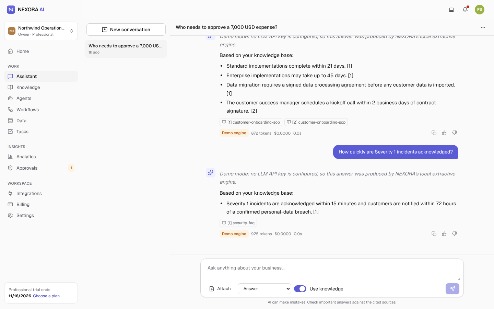
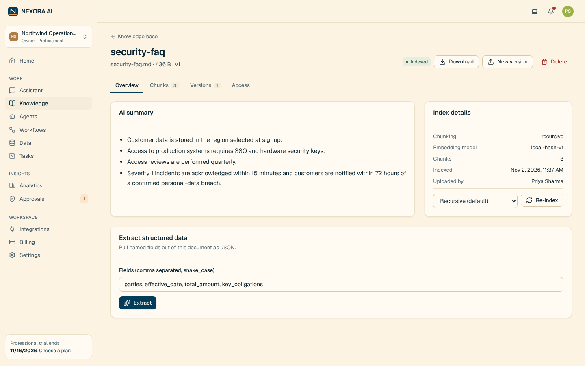
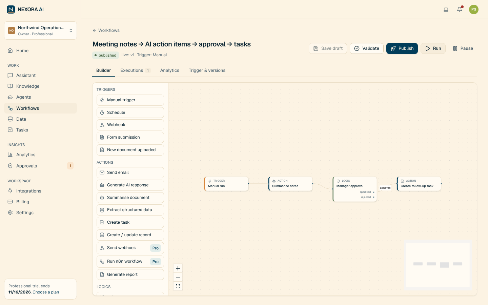
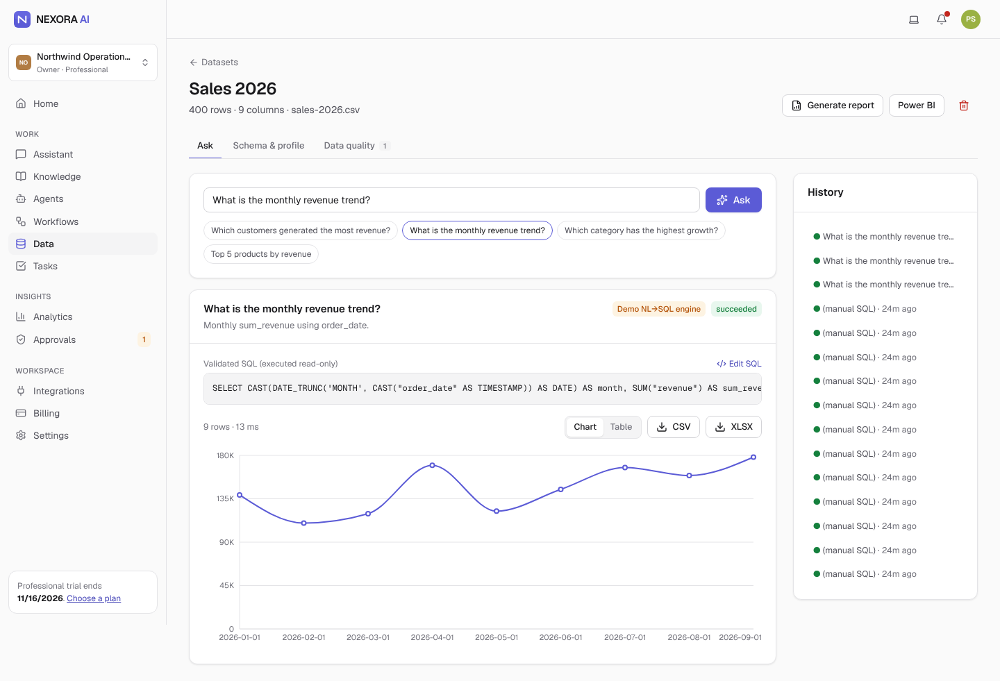
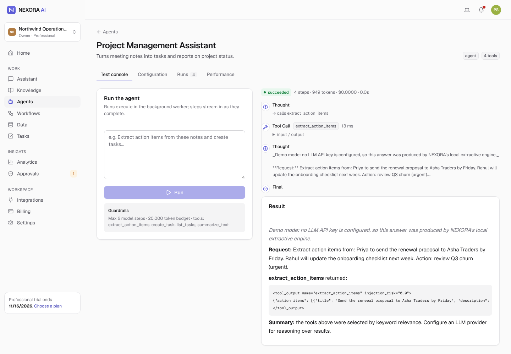
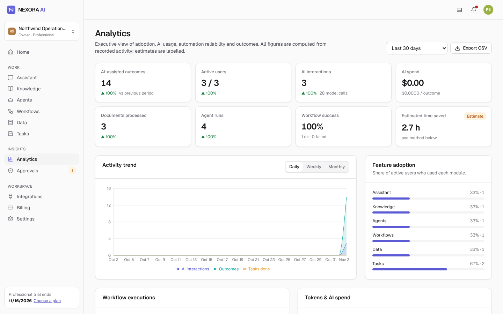

# Case Study — NEXORA AI
*AI business operations & workflow intelligence SaaS · independent product (strategy, design, build) · 2026*

> Honesty note: NEXORA has **not** been launched or tested with customers. Everything labelled "result" below comes from automated
> tests, a demo-engine evaluation and a hypothetical financial model. That is stated wherever it matters.

## 1. Executive summary
Growing companies run on knowledge trapped in documents and in a few people's heads. I set out to build a product that makes that
knowledge *queryable* and recurring work *automatable* — safely enough for real business data. In one build cycle I took NEXORA from
problem framing to a working, multi-tenant SaaS: cited answers, approval-gated agents and workflows, safe NL→SQL, AI task capture,
billing and an admin console, verified by 90 backend tests, 8 end-to-end journeys and an AI evaluation harness. The most important
PM outcome was a **pricing decision driven by the model**: heavy users on the planned Pro plan would erode gross margin to ~11%,
so I recommended capping included usage and adding credit packs before launch.

## 2. Business problem
Ops leaders are the human search engine of their companies; action items die in meeting notes; numbers questions wait for an analyst;
automations break silently. AI tools exist, but generic chat is ungrounded and ungoverned, and per-seat AI add-ons are expensive for
small teams. (MARKET_RESEARCH.md §3–4 — hypotheses to validate.)

## 3. Market opportunity
88% of organisations report using AI but most are not scaling it (McKinsey, 2025). India has ~7.3 crore registered MSMEs (Dec 2025).
TAM ~$21.6B / SAM ~$2.2B / Base SOM ~$1.3M ARR at 36 months (assumption-driven; MARKET_RESEARCH.md §2).

## 4. Competitive landscape
Suites (Notion AI, M365 Copilot) win distribution; assistants (ChatGPT/Claude teams) win model quality; automation (Zapier, n8n) wins
connectors; Glean wins enterprise search. **Gap:** governance + workflows + knowledge + measurement under one permission model at an
SMB team price. (COMPETITIVE_ANALYSIS.md)

## 5. Target audience
10–200 person digital-first companies; ops owner champion; founder/COO buyer; India first.

## 6. Customer personas
Ananya (Ops Manager, primary), Rohit (Founder, economic buyer), Meera (HR), Karan (Sales), Sara (CS), Dev (Analyst), Nikhil (Admin) —
hypothesis personas with explicit objections and product answers (USER_PERSONAS.md).

## 7. Jobs-to-be-done
"Give my team the right, current answer without pinging me" · "Turn this meeting into owned follow-ups" · "Answer a numbers
question now" · "Automate the hand-off but let me approve the risky step" · "Show leadership what AI saves and costs".

## 8. Product vision
One intelligent workspace where business knowledge is queryable, recurring work runs itself, and humans approve what matters.

## 9. Product strategy
Wedge: grounded Q&A → habit: notes→tasks → expansion: approval workflows, agents, data intelligence → retention: scheduled
workflows + outcome digest. Bets and kill signals in PRODUCT_STRATEGY.md §5.

## 10. Value proposition
Cited answers, owned tasks, approval-gated automation and safe data questions — with cost and outcomes visible — at a team price.

## 11. Product requirements
PRD with 40+ functional requirements across 12 modules, NFRs with verification methods and representative user stories with
acceptance criteria (PRD.md).

## 12. User journey
Sign-up → upload → cited answer in minutes; meeting notes → reviewed tasks; recipe workflow → approval → task (USER_JOURNEYS.md).

## 13. Wireframes
Lo-fi structures for shell, assistant and builder (USER_JOURNEYS.md) → implemented screens:

| Knowledge | Workflow builder | Data intelligence |
|---|---|---|
|  |  |  |

## 14. System architecture
Modular monolith (FastAPI) + worker, PostgreSQL/pgvector, Redis, Next.js; every tenant row carries `org_id`; all AI through one
gateway (TECHNICAL_ARCHITECTURE.md).

## 15. AI architecture
Task-based routing (Haiku for summaries/classification, Sonnet for chat/agents/extraction, Opus for analysis; OpenAI fallbacks),
prompt + response caching, PII redaction, cost ledger; hybrid RAG with verified citations; single-agent runtime with approvals;
AST-guarded NL→SQL (AI_ARCHITECTURE.md, RAG_DESIGN.md).

## 16. MVP definition
Must-haves that prove the wedge *safely*: auth/RBAC/tenancy, cited assistant, KB, notes→tasks, one agent with approvals, one
workflow with approval, plans/limits, metering. I scoped further (data, admin, integrations) because they were cheap on the same
foundations and necessary for a credible paid product.

## 17. Feature prioritisation
RICE for ordering, ICE for experiments, MoSCoW for releases, impact/effort sanity check, dependency map. Top RICE: signup (3000),
role-aware retrieval (2700), citations (2430), notes→tasks (1920). Deliberately excluded: multi-agent orchestration, 100+ connectors,
real-time co-editing (PRIORITISATION.md).

## 18. Product roadmap
MVP (built) → V1 design partners & India launch (monitoring, streaming, RLS, Razorpay, credit packs, private evals) → V2 connected
operations → operations intelligence (PRODUCT_ROADMAP.md).

## 19. Engineering execution
Six sprint-equivalents (auth → RAG/assistant → agents → workflows → data/tasks → billing/admin/evals/deploy). Testing found and fixed
10 real defects — e.g. an auto-generated migration that silently dropped vector indexes, a cache race on duplicate requests, form
labels not bound to inputs (accessibility), and a vulnerable transitive dependency (TEST_REPORT.md §5).

## 20. Product analytics
North Star = weekly successful AI-assisted outcomes, emitted only for completed, accepted actions (not AI calls). Metric tree,
KPI catalogue, Mixpanel taxonomy, SQL views for activation/retention/cost per outcome; time saved shown only as a labelled estimate
with published assumptions (ANALYTICS_FRAMEWORK.md).

## 21. Growth strategy
PLG reverse trial, templates and collaboration loops; content/communities; paid acquisition **only** for Pro-fit companies because
Starter LTV/CAC is 1.5× (GTM_STRATEGY.md).

## 22. Monetisation
Per-org seat bands (Free / $49 / $199 / custom), INR pricing, hard limits with no overage, Stripe adapter, Razorpay planned
(MONETISATION_STRATEGY.md).

## 23. Financial model
36-month, 3-scenario Excel model. Base: ~691 paying orgs, ~$1.31M ARR, 68% blended gross margin by month 36, ~$0.92M total capital
need, break-even just beyond 36 months. **Sensitivity insight:** Pro margin 63% at 35% utilisation → 11% at full utilisation (at
$0.009/message). Decision D-012: cap Pro at 5,000 included messages + credit packs; acquire Starter organically (FINANCIAL_MODEL.md).

## 24. Risk management
Risk register covering answer quality, cross-tenant leakage, margin erosion, provider outages, suite competition, sales cycles and
DPDP compliance, each with mitigation and owner (PRODUCT_ROADMAP.md).

## 25. Security
Threat model with 8 abuse cases (cross-tenant leakage, prompt injection, credential theft, cost attacks, malicious uploads,
unauthorised tools, SQL injection, SSRF) — mitigations implemented and tested; open findings are medium/low with plans (RLS, nonce CSP,
MFA) (SECURITY_REVIEW.md).

## 26. Testing
90 pytest · 6 Vitest · 8 Playwright journeys on dev and Docker production stack · 21-request Newman suite · AI eval (28/29 on demo
engine) · load test (0% errors at 20 concurrency; hybrid search p95 243 ms) · dependency audits clean.

## 27. Launch strategy
12-week plan: interviews → 5 design partners with private evals → India public beta with INR billing → launch → first experiments
(GTM_STRATEGY.md §8).

## 28. Product performance
**No production performance exists yet.** Pre-launch evidence: functional coverage above; demo-engine eval metrics; performance test.
The first real numbers to report will be time-to-first-value, week-1 outcome rate, trial→paid and cost per outcome from design partners.

## 29. Learnings
1. **The financial model is a product tool.** The pricing page looked reasonable until sensitivity analysis showed usage caps are a
   promise of *maximum* cost.
2. **Trust features are product features.** Role-aware retrieval and approvals were cheapest to build first and would have been
   expensive to retrofit.
3. **Define the North Star at the code level.** Deciding exactly where `outcome_achieved` fires forced clarity on what "value" means.
4. **Honest labelling compounds.** Demo mode, estimates and beta integrations are labelled everywhere — essential for credibility.
5. **Tests find product bugs, not just code bugs** — the accessibility defect was found by writing user-centric E2E tests.

## 30. Future roadmap
V1: observability, streaming, RLS, MFA, Razorpay, credit packs, Drive/Slack, private evals. V2: Jira/Confluence/HubSpot sync,
scheduled agents, SSO, ROI report. Beyond: proactive operations radar and AI-suggested workflows (gated by experiment E6).
