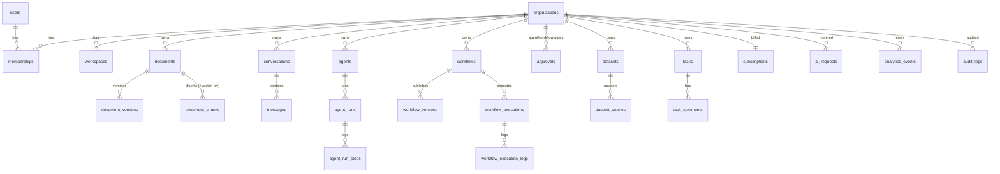

# Database Schema

PostgreSQL 16 + **pgvector 0.6** (+ Redis for rate limiting). Migrations: Alembic (`backend/alembic/versions`, 4 revisions).

## Design principles
1. **Tenant column everywhere.** Every tenant-owned table carries `org_id NOT NULL REFERENCES organizations ON DELETE CASCADE`
   (via `TenantMixin`). Application code always filters by the request's resolved `ctx.org_id`; deleting an organisation cascades.
2. **UUID primary keys** (no enumerable ids); foreign ids from another tenant return 404.
3. **Ledgers are append-only:** `ai_requests` (every model call, cost, latency), `analytics_events`, `audit_logs`,
   `agent_run_steps`, `workflow_execution_logs`.
4. **Resumable state in JSON:** `agent_runs.state` (provider-neutral messages + pending approvals), `workflow_executions.context`
   (queue, visited nodes, outputs, pause reason).
5. **Embedding versioning:** `document_chunks.embedding` is a dimension-less `vector` + `embedding_model`; per-model **HNSW
   expression indexes** (`(embedding::vector(384))` for `local-hash-v1`, `(embedding::vector(1536))` for `text-embedding-3-small`)
   let two embedding models coexist during a migration.
6. **Hybrid search:** `document_chunks.tsv` is a generated `tsvector` with a GIN index.
7. **Datasets are physical tables** in schema `datasets` (`ds_<random>`), never in `public`; LLM SQL can reference only the logical
   name `data`, rewritten to that table.
8. **Analytics layer:** schema `analytics` (views for Power BI / SQL), readable by role `nexora_readonly`.

## Entity overview

## Key indexes
`ix_chunks_hnsw_local`, `ix_chunks_hnsw_oai_small` (ANN), `ix_chunks_tsv` (GIN), `ix_chunks_org_doc`, `ix_events_org_event_time`,
`ix_ai_requests_org_time`, `ix_jobs_status_run_after`, plus `org_id` indexes on every tenant table.

## Retention
Organisation deletion: 7-day grace then cascade purge (files and dataset tables dropped by the `purge_org` job). User deletion:
anonymised profile, sessions revoked. Response cache entries expire after 24h. Recommended (ops): prune `analytics_events`
>25 months, `ai_requests` raw rows >13 months after aggregating.

<!-- GENERATED -->
## Table reference (generated by `scripts/generate_reference_docs.py`)

### Identity & tenancy

**`users`**

| Column | Type | Null | Notes |
|---|---|---|---|
| email | VARCHAR(320) | no | unique, indexed |
| password_hash | VARCHAR(255) | yes |  |
| full_name | VARCHAR(200) | no |  |
| job_title | VARCHAR(200) | yes |  |
| avatar_url | VARCHAR(500) | yes |  |
| is_active | BOOLEAN | no |  |
| is_super_admin | BOOLEAN | no |  |
| email_verified_at | DATETIME | yes |  |
| last_login_at | DATETIME | yes |  |
| onboarding_completed_at | DATETIME | yes |  |
| deleted_at | DATETIME | yes |  |
| failed_login_count | INTEGER | no |  |
| locked_until | DATETIME | yes |  |
| id | CHAR(32) | no | PK |
| created_at | DATETIME | no |  |
| updated_at | DATETIME | no |  |

**`user_sessions`**

| Column | Type | Null | Notes |
|---|---|---|---|
| user_id | CHAR(32) | no | FK → users.id (CASCADE), indexed |
| refresh_token_hash | VARCHAR(128) | no | unique, indexed |
| user_agent | VARCHAR(500) | yes |  |
| ip | VARCHAR(64) | yes |  |
| created_at | DATETIME | no |  |
| last_used_at | DATETIME | no |  |
| expires_at | DATETIME | no |  |
| revoked_at | DATETIME | yes |  |
| id | CHAR(32) | no | PK |

**`auth_tokens`**

| Column | Type | Null | Notes |
|---|---|---|---|
| user_id | CHAR(32) | no | FK → users.id (CASCADE), indexed |
| kind | VARCHAR(32) | no |  |
| token_hash | VARCHAR(128) | no | unique, indexed |
| expires_at | DATETIME | no |  |
| used_at | DATETIME | yes |  |
| created_at | DATETIME | no |  |
| id | CHAR(32) | no | PK |

**`oauth_accounts`**

| Column | Type | Null | Notes |
|---|---|---|---|
| user_id | CHAR(32) | no | FK → users.id (CASCADE), indexed |
| provider | VARCHAR(32) | no |  |
| provider_user_id | VARCHAR(255) | no |  |
| id | CHAR(32) | no | PK |
| created_at | DATETIME | no |  |
| updated_at | DATETIME | no |  |

**`organizations`**

| Column | Type | Null | Notes |
|---|---|---|---|
| name | VARCHAR(200) | no |  |
| slug | VARCHAR(80) | no | unique, indexed |
| industry | VARCHAR(100) | yes |  |
| size | VARCHAR(50) | yes |  |
| settings | JSON | no |  |
| is_suspended | BOOLEAN | no |  |
| deletion_requested_at | DATETIME | yes |  |
| deleted_at | DATETIME | yes |  |
| id | CHAR(32) | no | PK |
| created_at | DATETIME | no |  |
| updated_at | DATETIME | no |  |

**`memberships`** — tenant-scoped (`org_id NOT NULL`)

| Column | Type | Null | Notes |
|---|---|---|---|
| org_id | CHAR(32) | no | FK → organizations.id (CASCADE), indexed |
| user_id | CHAR(32) | no | FK → users.id (CASCADE), indexed |
| role | VARCHAR(20) | no |  |
| status | VARCHAR(20) | no |  |
| id | CHAR(32) | no | PK |
| created_at | DATETIME | no |  |
| updated_at | DATETIME | no |  |

**`invitations`** — tenant-scoped (`org_id NOT NULL`)

| Column | Type | Null | Notes |
|---|---|---|---|
| email | VARCHAR(320) | no | indexed |
| role | VARCHAR(20) | no |  |
| token_hash | VARCHAR(128) | no | unique |
| invited_by | CHAR(32) | yes | FK → users.id (SET NULL) |
| expires_at | DATETIME | no |  |
| accepted_at | DATETIME | yes |  |
| revoked_at | DATETIME | yes |  |
| created_at | DATETIME | no |  |
| id | CHAR(32) | no | PK |
| org_id | CHAR(32) | no | FK → organizations.id (CASCADE), indexed |

**`workspaces`** — tenant-scoped (`org_id NOT NULL`)

| Column | Type | Null | Notes |
|---|---|---|---|
| name | VARCHAR(200) | no |  |
| description | TEXT | yes |  |
| created_by | CHAR(32) | yes | FK → users.id (SET NULL) |
| is_default | BOOLEAN | no |  |
| id | CHAR(32) | no | PK |
| org_id | CHAR(32) | no | FK → organizations.id (CASCADE), indexed |
| created_at | DATETIME | no |  |
| updated_at | DATETIME | no |  |

### Assistant

**`conversations`** — tenant-scoped (`org_id NOT NULL`)

| Column | Type | Null | Notes |
|---|---|---|---|
| user_id | CHAR(32) | no | FK → users.id (CASCADE), indexed |
| workspace_id | CHAR(32) | yes | FK → workspaces.id (SET NULL) |
| title | VARCHAR(300) | no |  |
| model_route | VARCHAR(40) | no |  |
| use_knowledge | BOOLEAN | no |  |
| archived | BOOLEAN | no |  |
| id | CHAR(32) | no | PK |
| org_id | CHAR(32) | no | FK → organizations.id (CASCADE), indexed |
| created_at | DATETIME | no |  |
| updated_at | DATETIME | no |  |

**`conversation_shares`** — tenant-scoped (`org_id NOT NULL`)

| Column | Type | Null | Notes |
|---|---|---|---|
| conversation_id | CHAR(32) | no | FK → conversations.id (CASCADE), indexed |
| user_id | CHAR(32) | no | FK → users.id (CASCADE) |
| permission | VARCHAR(10) | no |  |
| created_at | DATETIME | no |  |
| id | CHAR(32) | no | PK |
| org_id | CHAR(32) | no | FK → organizations.id (CASCADE), indexed |

**`messages`** — tenant-scoped (`org_id NOT NULL`)

| Column | Type | Null | Notes |
|---|---|---|---|
| conversation_id | CHAR(32) | no | FK → conversations.id (CASCADE), indexed |
| role | VARCHAR(20) | no |  |
| content | TEXT | no |  |
| citations | JSON | no |  |
| attachments | JSON | no |  |
| meta | JSON | no |  |
| feedback | INTEGER | yes |  |
| created_at | DATETIME | no |  |
| id | CHAR(32) | no | PK |
| org_id | CHAR(32) | no | FK → organizations.id (CASCADE), indexed |

### Knowledge / RAG

**`documents`** — tenant-scoped (`org_id NOT NULL`)

| Column | Type | Null | Notes |
|---|---|---|---|
| workspace_id | CHAR(32) | yes | FK → workspaces.id (SET NULL) |
| title | VARCHAR(300) | no |  |
| filename | VARCHAR(300) | no |  |
| mime_type | VARCHAR(120) | no |  |
| file_type | VARCHAR(10) | no |  |
| size_bytes | INTEGER | no |  |
| storage_key | VARCHAR(500) | no |  |
| checksum | VARCHAR(64) | no | indexed |
| status | VARCHAR(20) | no |  |
| error | TEXT | yes |  |
| version | INTEGER | no |  |
| uploaded_by | CHAR(32) | yes | FK → users.id (SET NULL) |
| min_role | VARCHAR(20) | no |  |
| allowed_user_ids | JSON | no |  |
| tags | JSON | no |  |
| doc_metadata | JSON | no |  |
| summary | TEXT | yes |  |
| page_count | INTEGER | yes |  |
| chunk_count | INTEGER | no |  |
| chunking_strategy | VARCHAR(30) | no |  |
| embedding_model | VARCHAR(80) | yes |  |
| injection_flags | INTEGER | no |  |
| indexed_at | DATETIME | yes |  |
| deleted_at | DATETIME | yes | indexed |
| id | CHAR(32) | no | PK |
| org_id | CHAR(32) | no | FK → organizations.id (CASCADE), indexed |
| created_at | DATETIME | no |  |
| updated_at | DATETIME | no |  |

**`document_versions`** — tenant-scoped (`org_id NOT NULL`)

| Column | Type | Null | Notes |
|---|---|---|---|
| document_id | CHAR(32) | no | FK → documents.id (CASCADE), indexed |
| version | INTEGER | no |  |
| filename | VARCHAR(300) | no |  |
| storage_key | VARCHAR(500) | no |  |
| checksum | VARCHAR(64) | no |  |
| size_bytes | INTEGER | no |  |
| created_by | CHAR(32) | yes | FK → users.id (SET NULL) |
| created_at | DATETIME | no |  |
| id | CHAR(32) | no | PK |
| org_id | CHAR(32) | no | FK → organizations.id (CASCADE), indexed |

**`document_chunks`** — tenant-scoped (`org_id NOT NULL`)

| Column | Type | Null | Notes |
|---|---|---|---|
| document_id | CHAR(32) | no | FK → documents.id (CASCADE) |
| version | INTEGER | no |  |
| chunk_index | INTEGER | no |  |
| content | TEXT | no |  |
| token_count | INTEGER | no |  |
| page | INTEGER | yes |  |
| section | VARCHAR(300) | yes |  |
| meta | JSON | no |  |
| embedding | VECTOR | yes |  |
| embedding_model | VARCHAR(80) | yes | indexed |
| injection_risk | FLOAT | no |  |
| tsv | TSVECTOR | yes | generated |
| id | CHAR(32) | no | PK |
| org_id | CHAR(32) | no | FK → organizations.id (CASCADE), indexed |

### Agents & approvals

**`agents`** — tenant-scoped (`org_id NOT NULL`)

| Column | Type | Null | Notes |
|---|---|---|---|
| name | VARCHAR(200) | no |  |
| description | TEXT | no |  |
| instructions | TEXT | no |  |
| template_key | VARCHAR(60) | yes |  |
| model_route | VARCHAR(40) | no |  |
| knowledge_document_ids | JSON | yes |  |
| use_knowledge | BOOLEAN | no |  |
| tools | JSON | no |  |
| approval_required_tools | JSON | no |  |
| memory_enabled | BOOLEAN | no |  |
| memory | JSON | no |  |
| max_steps | INTEGER | no |  |
| max_tokens_per_run | INTEGER | no |  |
| output_format | VARCHAR(20) | no |  |
| output_schema | JSON | yes |  |
| status | VARCHAR(20) | no |  |
| created_by | CHAR(32) | yes | FK → users.id (SET NULL) |
| id | CHAR(32) | no | PK |
| org_id | CHAR(32) | no | FK → organizations.id (CASCADE), indexed |
| created_at | DATETIME | no |  |
| updated_at | DATETIME | no |  |

**`agent_runs`** — tenant-scoped (`org_id NOT NULL`)

| Column | Type | Null | Notes |
|---|---|---|---|
| agent_id | CHAR(32) | no | FK → agents.id (CASCADE), indexed |
| user_id | CHAR(32) | yes | FK → users.id (SET NULL) |
| input | TEXT | no |  |
| status | VARCHAR(30) | no |  |
| output | TEXT | yes |  |
| structured_output | JSON | yes |  |
| error | TEXT | yes |  |
| state | JSON | no |  |
| steps_count | INTEGER | no |  |
| total_tokens | INTEGER | no |  |
| cost_usd | NUMERIC(12, 6) | no |  |
| created_at | DATETIME | no | indexed |
| started_at | DATETIME | yes |  |
| finished_at | DATETIME | yes |  |
| id | CHAR(32) | no | PK |
| org_id | CHAR(32) | no | FK → organizations.id (CASCADE), indexed |

**`agent_run_steps`** — tenant-scoped (`org_id NOT NULL`)

| Column | Type | Null | Notes |
|---|---|---|---|
| run_id | CHAR(32) | no | FK → agent_runs.id (CASCADE), indexed |
| idx | INTEGER | no |  |
| type | VARCHAR(30) | no |  |
| tool | VARCHAR(60) | yes |  |
| input | JSON | yes |  |
| output | JSON | yes |  |
| status | VARCHAR(20) | no |  |
| latency_ms | INTEGER | no |  |
| attempt | INTEGER | no |  |
| created_at | DATETIME | no |  |
| id | CHAR(32) | no | PK |
| org_id | CHAR(32) | no | FK → organizations.id (CASCADE), indexed |

**`approvals`** — tenant-scoped (`org_id NOT NULL`)

| Column | Type | Null | Notes |
|---|---|---|---|
| source_type | VARCHAR(30) | no |  |
| source_id | CHAR(32) | no | indexed |
| title | VARCHAR(300) | no |  |
| details | JSON | no |  |
| status | VARCHAR(20) | no |  |
| required_role | VARCHAR(20) | no |  |
| requested_by | CHAR(32) | yes | FK → users.id (SET NULL) |
| decided_by | CHAR(32) | yes | FK → users.id (SET NULL) |
| decision_note | TEXT | yes |  |
| decided_at | DATETIME | yes |  |
| created_at | DATETIME | no | indexed |
| id | CHAR(32) | no | PK |
| org_id | CHAR(32) | no | FK → organizations.id (CASCADE), indexed |

### Workflows

**`workflows`** — tenant-scoped (`org_id NOT NULL`)

| Column | Type | Null | Notes |
|---|---|---|---|
| name | VARCHAR(200) | no |  |
| description | TEXT | no |  |
| status | VARCHAR(20) | no |  |
| draft_definition | JSON | no |  |
| published_version | INTEGER | yes |  |
| trigger_type | VARCHAR(30) | no |  |
| schedule_cron | VARCHAR(100) | yes |  |
| next_run_at | DATETIME | yes | indexed |
| webhook_token | VARCHAR(64) | yes | unique |
| webhook_secret_enc | TEXT | yes |  |
| created_by | CHAR(32) | yes | FK → users.id (SET NULL) |
| id | CHAR(32) | no | PK |
| org_id | CHAR(32) | no | FK → organizations.id (CASCADE), indexed |
| created_at | DATETIME | no |  |
| updated_at | DATETIME | no |  |

**`workflow_versions`** — tenant-scoped (`org_id NOT NULL`)

| Column | Type | Null | Notes |
|---|---|---|---|
| workflow_id | CHAR(32) | no | FK → workflows.id (CASCADE), indexed |
| version | INTEGER | no |  |
| definition | JSON | no |  |
| published_by | CHAR(32) | yes | FK → users.id (SET NULL) |
| created_at | DATETIME | no |  |
| id | CHAR(32) | no | PK |
| org_id | CHAR(32) | no | FK → organizations.id (CASCADE), indexed |

**`workflow_executions`** — tenant-scoped (`org_id NOT NULL`)

| Column | Type | Null | Notes |
|---|---|---|---|
| workflow_id | CHAR(32) | no | FK → workflows.id (CASCADE), indexed |
| version | INTEGER | no |  |
| trigger | VARCHAR(30) | no |  |
| status | VARCHAR(30) | no |  |
| input | JSON | no |  |
| output | JSON | yes |  |
| context | JSON | no |  |
| error | TEXT | yes |  |
| attempt | INTEGER | no |  |
| retry_of | CHAR(32) | yes |  |
| triggered_by | CHAR(32) | yes | FK → users.id (SET NULL) |
| created_at | DATETIME | no | indexed |
| started_at | DATETIME | yes |  |
| finished_at | DATETIME | yes |  |
| duration_ms | INTEGER | yes |  |
| id | CHAR(32) | no | PK |
| org_id | CHAR(32) | no | FK → organizations.id (CASCADE), indexed |

**`workflow_execution_logs`** — tenant-scoped (`org_id NOT NULL`)

| Column | Type | Null | Notes |
|---|---|---|---|
| execution_id | CHAR(32) | no | FK → workflow_executions.id (CASCADE), indexed |
| node_id | VARCHAR(60) | no |  |
| node_type | VARCHAR(40) | no |  |
| status | VARCHAR(20) | no |  |
| input | JSON | yes |  |
| output | JSON | yes |  |
| error | TEXT | yes |  |
| started_at | DATETIME | no |  |
| duration_ms | INTEGER | no |  |
| id | CHAR(32) | no | PK |
| org_id | CHAR(32) | no | FK → organizations.id (CASCADE), indexed |

**`form_submissions`** — tenant-scoped (`org_id NOT NULL`)

| Column | Type | Null | Notes |
|---|---|---|---|
| workflow_id | CHAR(32) | no | FK → workflows.id (CASCADE), indexed |
| data | JSON | no |  |
| created_at | DATETIME | no |  |
| id | CHAR(32) | no | PK |
| org_id | CHAR(32) | no | FK → organizations.id (CASCADE), indexed |

**`records`** — tenant-scoped (`org_id NOT NULL`)

| Column | Type | Null | Notes |
|---|---|---|---|
| collection | VARCHAR(60) | no | indexed |
| data | JSON | no |  |
| id | CHAR(32) | no | PK |
| org_id | CHAR(32) | no | FK → organizations.id (CASCADE), indexed |
| created_at | DATETIME | no |  |
| updated_at | DATETIME | no |  |

### Data intelligence

**`datasets`** — tenant-scoped (`org_id NOT NULL`)

| Column | Type | Null | Notes |
|---|---|---|---|
| name | VARCHAR(200) | no |  |
| filename | VARCHAR(300) | no |  |
| table_name | VARCHAR(80) | no | unique |
| row_count | INTEGER | no |  |
| columns | JSON | no |  |
| profile | JSON | no |  |
| recommendations | JSON | no |  |
| status | VARCHAR(20) | no |  |
| created_by | CHAR(32) | yes | FK → users.id (SET NULL) |
| id | CHAR(32) | no | PK |
| org_id | CHAR(32) | no | FK → organizations.id (CASCADE), indexed |
| created_at | DATETIME | no |  |
| updated_at | DATETIME | no |  |

**`dataset_queries`** — tenant-scoped (`org_id NOT NULL`)

| Column | Type | Null | Notes |
|---|---|---|---|
| dataset_id | CHAR(32) | no | FK → datasets.id (CASCADE), indexed |
| user_id | CHAR(32) | yes | FK → users.id (SET NULL) |
| question | TEXT | no |  |
| generated_sql | TEXT | yes |  |
| executed_sql | TEXT | yes |  |
| status | VARCHAR(20) | no |  |
| row_count | INTEGER | no |  |
| chart | JSON | yes |  |
| explanation | TEXT | yes |  |
| error | TEXT | yes |  |
| latency_ms | INTEGER | no |  |
| created_at | DATETIME | no |  |
| id | CHAR(32) | no | PK |
| org_id | CHAR(32) | no | FK → organizations.id (CASCADE), indexed |

### Tasks

**`tasks`** — tenant-scoped (`org_id NOT NULL`)

| Column | Type | Null | Notes |
|---|---|---|---|
| workspace_id | CHAR(32) | yes | FK → workspaces.id (SET NULL) |
| title | VARCHAR(300) | no |  |
| description | TEXT | no |  |
| status | VARCHAR(20) | no |  |
| priority | VARCHAR(10) | no |  |
| assignee_id | CHAR(32) | yes | FK → users.id (SET NULL), indexed |
| due_date | DATE | yes |  |
| labels | JSON | no |  |
| source | VARCHAR(20) | no |  |
| position | FLOAT | no |  |
| created_by | CHAR(32) | yes | FK → users.id (SET NULL) |
| completed_at | DATETIME | yes |  |
| id | CHAR(32) | no | PK |
| org_id | CHAR(32) | no | FK → organizations.id (CASCADE), indexed |
| created_at | DATETIME | no |  |
| updated_at | DATETIME | no |  |

**`task_comments`** — tenant-scoped (`org_id NOT NULL`)

| Column | Type | Null | Notes |
|---|---|---|---|
| task_id | CHAR(32) | no | FK → tasks.id (CASCADE), indexed |
| user_id | CHAR(32) | yes | FK → users.id (SET NULL) |
| body | TEXT | no |  |
| created_at | DATETIME | no |  |
| id | CHAR(32) | no | PK |
| org_id | CHAR(32) | no | FK → organizations.id (CASCADE), indexed |

**`task_attachments`** — tenant-scoped (`org_id NOT NULL`)

| Column | Type | Null | Notes |
|---|---|---|---|
| task_id | CHAR(32) | no | FK → tasks.id (CASCADE), indexed |
| filename | VARCHAR(300) | no |  |
| storage_key | VARCHAR(500) | no |  |
| size_bytes | INTEGER | no |  |
| uploaded_by | CHAR(32) | yes | FK → users.id (SET NULL) |
| created_at | DATETIME | no |  |
| id | CHAR(32) | no | PK |
| org_id | CHAR(32) | no | FK → organizations.id (CASCADE), indexed |

**`task_activity`** — tenant-scoped (`org_id NOT NULL`)

| Column | Type | Null | Notes |
|---|---|---|---|
| task_id | CHAR(32) | no | FK → tasks.id (CASCADE), indexed |
| user_id | CHAR(32) | yes | FK → users.id (SET NULL) |
| action | VARCHAR(50) | no |  |
| details | JSON | no |  |
| created_at | DATETIME | no |  |
| id | CHAR(32) | no | PK |
| org_id | CHAR(32) | no | FK → organizations.id (CASCADE), indexed |

### Billing & usage

**`subscriptions`** — tenant-scoped (`org_id NOT NULL`)

| Column | Type | Null | Notes |
|---|---|---|---|
| plan | VARCHAR(30) | no |  |
| status | VARCHAR(20) | no |  |
| provider | VARCHAR(20) | no |  |
| provider_customer_id | VARCHAR(100) | yes |  |
| provider_subscription_id | VARCHAR(100) | yes |  |
| trial_ends_at | DATETIME | yes |  |
| current_period_start | DATETIME | yes |  |
| current_period_end | DATETIME | yes |  |
| cancel_at_period_end | BOOLEAN | no |  |
| custom_limits | JSON | no |  |
| seats | INTEGER | no |  |
| id | CHAR(32) | no | PK |
| org_id | CHAR(32) | no | FK → organizations.id (CASCADE), indexed |
| created_at | DATETIME | no |  |
| updated_at | DATETIME | no |  |

**`invoices`** — tenant-scoped (`org_id NOT NULL`)

| Column | Type | Null | Notes |
|---|---|---|---|
| number | VARCHAR(40) | no | unique |
| amount_cents | INTEGER | no |  |
| currency | VARCHAR(3) | no |  |
| status | VARCHAR(20) | no |  |
| description | VARCHAR(300) | no |  |
| period_start | DATETIME | yes |  |
| period_end | DATETIME | yes |  |
| provider_invoice_id | VARCHAR(100) | yes |  |
| hosted_url | VARCHAR(500) | yes |  |
| created_at | DATETIME | no |  |
| id | CHAR(32) | no | PK |
| org_id | CHAR(32) | no | FK → organizations.id (CASCADE), indexed |

**`usage_counters`** — tenant-scoped (`org_id NOT NULL`)

| Column | Type | Null | Notes |
|---|---|---|---|
| org_id | CHAR(32) | no | PK, FK → organizations.id (CASCADE) |
| metric | VARCHAR(50) | no | PK |
| period | VARCHAR(7) | no | PK |
| value | INTEGER | no |  |

### AI ledger & caching

**`ai_requests`**

| Column | Type | Null | Notes |
|---|---|---|---|
| org_id | CHAR(32) | yes | FK → organizations.id (CASCADE) |
| user_id | CHAR(32) | yes | FK → users.id (SET NULL) |
| feature | VARCHAR(50) | no |  |
| task_type | VARCHAR(50) | no |  |
| provider | VARCHAR(30) | no |  |
| model | VARCHAR(100) | no |  |
| input_tokens | INTEGER | no |  |
| output_tokens | INTEGER | no |  |
| cached_tokens | INTEGER | no |  |
| cost_usd | NUMERIC(12, 6) | no |  |
| latency_ms | INTEGER | no |  |
| status | VARCHAR(20) | no |  |
| error | TEXT | yes |  |
| fallback_used | BOOLEAN | no |  |
| cache_hit | BOOLEAN | no |  |
| created_at | DATETIME | no |  |
| id | CHAR(32) | no | PK |

**`ai_response_cache`**

| Column | Type | Null | Notes |
|---|---|---|---|
| key | VARCHAR(128) | no | PK |
| org_id | CHAR(32) | yes | FK → organizations.id (CASCADE), indexed |
| response | JSON | no |  |
| created_at | DATETIME | no |  |
| expires_at | DATETIME | no |  |

### Platform

**`jobs`**

| Column | Type | Null | Notes |
|---|---|---|---|
| org_id | CHAR(32) | yes | FK → organizations.id (CASCADE), indexed |
| kind | VARCHAR(50) | no |  |
| payload | JSON | no |  |
| status | VARCHAR(20) | no |  |
| attempts | INTEGER | no |  |
| max_attempts | INTEGER | no |  |
| run_after | DATETIME | no |  |
| locked_at | DATETIME | yes |  |
| last_error | TEXT | yes |  |
| created_at | DATETIME | no |  |
| finished_at | DATETIME | yes |  |
| id | CHAR(32) | no | PK |

**`notifications`** — tenant-scoped (`org_id NOT NULL`)

| Column | Type | Null | Notes |
|---|---|---|---|
| user_id | CHAR(32) | no | FK → users.id (CASCADE), indexed |
| type | VARCHAR(50) | no |  |
| title | VARCHAR(300) | no |  |
| body | TEXT | yes |  |
| link | VARCHAR(500) | yes |  |
| read_at | DATETIME | yes |  |
| created_at | DATETIME | no | indexed |
| id | CHAR(32) | no | PK |
| org_id | CHAR(32) | no | FK → organizations.id (CASCADE), indexed |

**`notification_preferences`** — tenant-scoped (`org_id NOT NULL`)

| Column | Type | Null | Notes |
|---|---|---|---|
| user_id | CHAR(32) | no | PK, FK → users.id (CASCADE) |
| org_id | CHAR(32) | no | PK, FK → organizations.id (CASCADE) |
| prefs | JSON | no |  |

**`email_outbox`**

| Column | Type | Null | Notes |
|---|---|---|---|
| to_email | VARCHAR(320) | no | indexed |
| subject | VARCHAR(300) | no |  |
| body | TEXT | no |  |
| kind | VARCHAR(50) | no |  |
| status | VARCHAR(20) | no |  |
| error | TEXT | yes |  |
| created_at | DATETIME | no |  |
| id | CHAR(32) | no | PK |

**`integration_connections`** — tenant-scoped (`org_id NOT NULL`)

| Column | Type | Null | Notes |
|---|---|---|---|
| provider | VARCHAR(40) | no |  |
| status | VARCHAR(20) | no |  |
| auth_type | VARCHAR(20) | no |  |
| encrypted_credentials | TEXT | yes |  |
| scopes | JSON | no |  |
| config | JSON | no |  |
| connected_by | CHAR(32) | yes | FK → users.id (SET NULL) |
| last_tested_at | DATETIME | yes |  |
| last_error | TEXT | yes |  |
| oauth_state | VARCHAR(128) | yes |  |
| id | CHAR(32) | no | PK |
| org_id | CHAR(32) | no | FK → organizations.id (CASCADE), indexed |
| created_at | DATETIME | no |  |
| updated_at | DATETIME | no |  |

**`integration_logs`** — tenant-scoped (`org_id NOT NULL`)

| Column | Type | Null | Notes |
|---|---|---|---|
| provider | VARCHAR(40) | no |  |
| action | VARCHAR(50) | no |  |
| status | VARCHAR(20) | no |  |
| message | TEXT | yes |  |
| created_at | DATETIME | no | indexed |
| id | CHAR(32) | no | PK |
| org_id | CHAR(32) | no | FK → organizations.id (CASCADE), indexed |

**`feature_flags`**

| Column | Type | Null | Notes |
|---|---|---|---|
| key | VARCHAR(80) | no | PK |
| description | VARCHAR(300) | no |  |
| enabled | BOOLEAN | no |  |
| org_overrides | JSON | no |  |
| updated_at | DATETIME | no |  |

**`support_tickets`** — tenant-scoped (`org_id NOT NULL`)

| Column | Type | Null | Notes |
|---|---|---|---|
| user_id | CHAR(32) | yes | FK → users.id (SET NULL) |
| subject | VARCHAR(300) | no |  |
| body | TEXT | no |  |
| status | VARCHAR(20) | no |  |
| priority | VARCHAR(20) | no |  |
| admin_note | TEXT | yes |  |
| id | CHAR(32) | no | PK |
| org_id | CHAR(32) | no | FK → organizations.id (CASCADE), indexed |
| created_at | DATETIME | no |  |
| updated_at | DATETIME | no |  |

**`experiment_assignments`**

| Column | Type | Null | Notes |
|---|---|---|---|
| experiment_key | VARCHAR(80) | no | indexed |
| subject_id | VARCHAR(64) | no |  |
| variant | VARCHAR(40) | no |  |
| created_at | DATETIME | no |  |
| id | CHAR(32) | no | PK |

**`eval_runs`**

| Column | Type | Null | Notes |
|---|---|---|---|
| name | VARCHAR(200) | no |  |
| config | JSON | no |  |
| metrics | JSON | no |  |
| results | JSON | no |  |
| created_at | DATETIME | no |  |
| id | CHAR(32) | no | PK |

**`audit_logs`**

| Column | Type | Null | Notes |
|---|---|---|---|
| org_id | CHAR(32) | yes | FK → organizations.id (CASCADE), indexed |
| actor_id | CHAR(32) | yes | FK → users.id (SET NULL) |
| action | VARCHAR(100) | no | indexed |
| target_type | VARCHAR(50) | yes |  |
| target_id | VARCHAR(64) | yes |  |
| details | JSON | no |  |
| ip | VARCHAR(64) | yes |  |
| created_at | DATETIME | no | indexed |
| id | CHAR(32) | no | PK |

**`analytics_events`**

| Column | Type | Null | Notes |
|---|---|---|---|
| org_id | CHAR(32) | yes | FK → organizations.id (CASCADE), indexed |
| user_id | CHAR(32) | yes | FK → users.id (SET NULL), indexed |
| event | VARCHAR(80) | no |  |
| properties | JSON | no |  |
| created_at | DATETIME | no |  |
| id | CHAR(32) | no | PK |
